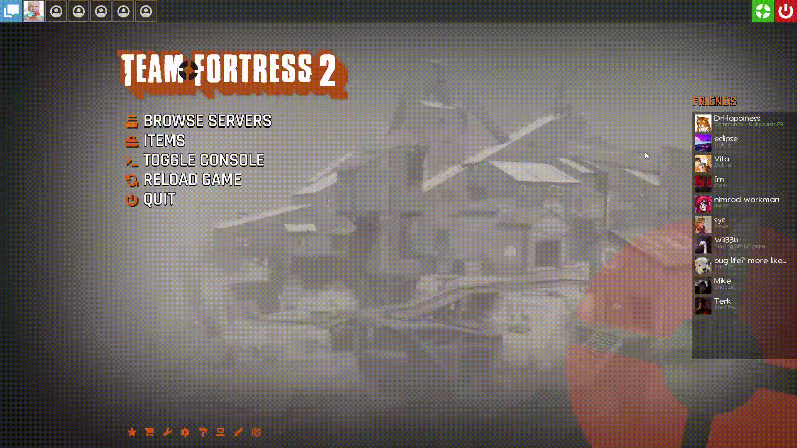

#  Installing CompHUD

1. Close Team Fortress 2.
2. Open [Releases](https://github.com/JoeShade/CompHUD/releases) and download **CompHUD.zip** from the release's **Assets**.
3. Extract the ZIP. It contains a ready-to-install `CompHUD` folder.
4. In Steam, right-click **Team Fortress 2**, select **Manage > Browse local files**, then open `tf/custom`. Create the `custom` folder if needed.
5. Move your existing HUD to a backup location outside `tf/custom`, then place `CompHUD` in `tf/custom`.
6. Launch TF2.

The installed folder should look like this:

```text
Team Fortress 2/
└── tf/
    └── custom/
        └── CompHUD/
            ├── cfg/
            ├── materials/
            ├── resource/
            ├── scripts/
            └── info.vdf
```

## Manual Über timer

Add this block to the end of `Team Fortress 2/tf/cfg/autoexec.cfg`. Create the file if it does not exist:

```cfg
exec comphud_options_init
bind "YOUR_KEY" "voicemenu 2 6; compHUD_uber_timer_press"
```

Replace `YOUR_KEY` with your preferred key. This loads your saved CompHUD preferences and applies the binding whenever TF2 starts.

Save the file and restart TF2. Open the paint-roller button in the main menu or pause menu and enable **Competitive captions** and **Uber timer**.

<p align="center">
  
</p>

Press your chosen key to trigger the voice command and manual timer together.

## Main menu shortcuts

Customise the two shortcut buttons in the main menu with your own hover text and console commands.

1. Open the paint-roller button in the main menu or pause menu, then select **Menu shortcuts**.
2. Under **HUD SHORTCUTS**, edit **Shortcut1 tooltip** and **Shortcut2 tooltip** to set each button's hover text.
3. Edit **Shortcut1 command** and **Shortcut2 command** to choose what each button runs.
4. Click **OK** to save, then restart TF2 for the changes to take effect.

> [!IMPORTANT]
> Console commands must start with `engine`, for example `engine map tr_walkway_rc2`.

## Updating

1. Close TF2 and move the installed `CompHUD` folder to a backup location outside `tf/custom`.
2. Download and install the updated folder using the steps above.
3. Restart TF2.

CompHUD saves its HUD preferences and menu shortcuts in `tf/cfg`, so they persist when the HUD folder is replaced.

[Back to CompHUD](../README.md)
